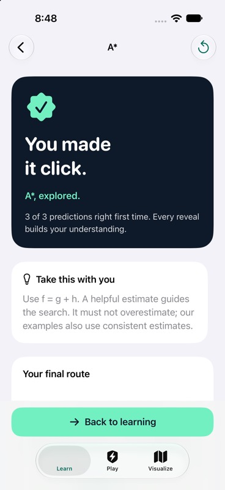
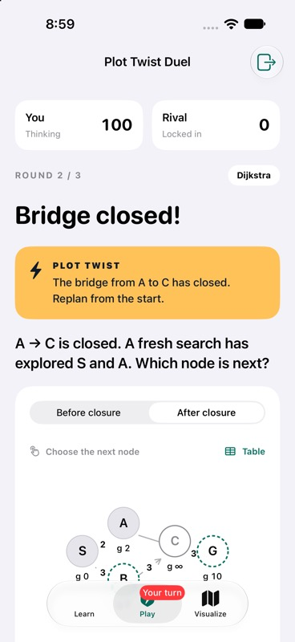
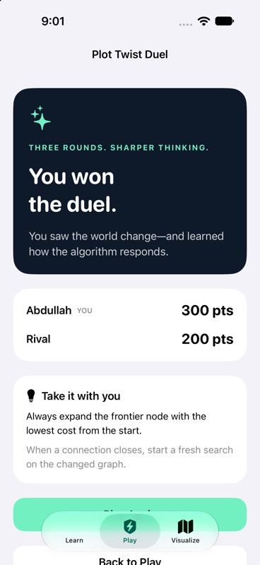
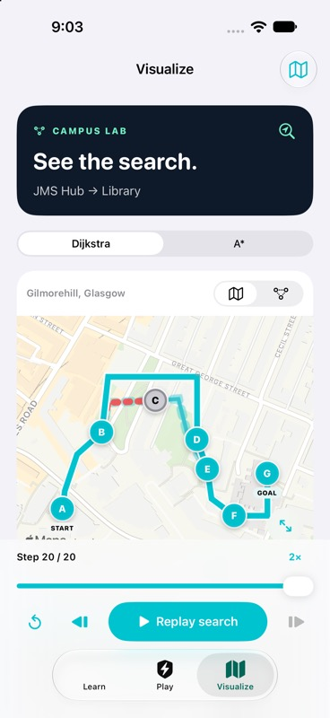

# Three-tab hackathon build

Implemented on `feat/plot-twist-duel`, based on `1834457`. The checkpoint journey is replaced by **Learn**, **Play**, and **Visualize**. The existing outdoor implementation remains in source but is no longer the app entry flow.

## Two-minute demo

1. **Learn:** open Dijkstra, predict a node, reveal the worked answer, then show the replay. A* has a separate four-step lesson with cost arithmetic and a new-graph transfer check. Progress saves locally.
2. **Play:** give each phone a nickname. Create a Duel on one, join its six-character code on the other, ready both, then start from the host. Submit one prediction first to show the privacy gate. Submit the second to reveal both answers, points, and an engine-generated replay.
3. Advance both players. **Bridge closed!** removes A→C. Compare Before/After, then make a fresh prediction. Round three changes the topology. Both players advance after its reveal to see matching results. The host can rematch.
4. **Visualize:** run the campus search. Close the Gardens path, replay, and compare Dijkstra with A*. The dashed original route and closed edge explain the detour. The alternate “Library cut off” condition demonstrates an unreachable goal.

Multiplayer needs internet access to the configured Supabase project. Lessons and graph calculations run locally. Map tiles may need network access. This is an educational campus model, not a surveyed navigation route.

## Validation — 17 October 2026

| Check | Result |
|---|---|
| Native Debug build, Swift 6 / iOS 17 deployment target | Passed with XcodeBuildMCP; only the expected unused AppIntents metadata warning |
| Core Swift package | 44 tests passed, including graph-oracle, lesson, duel-content and campus-disruption coverage |
| Real production DuelStore recovery harness | 12/12 passed; exact retry payload, stale revision/round reconciliation, persistence, cancellation, and late-response races |
| Independent algorithm/content verification | 22 golden search traces and 12 existing authored challenges passed |
| Local and hosted duel backend | 15 grouped checks each passed for both algorithms; authentication, privacy, capacity, concurrent submissions, scoring, rematch and leave |
| Hosted JSON → Swift contract | Three focused tests passed, including six canonical duel traces |
| Dijkstra full multiplayer UI | Two independent iPhone simulators, real anonymous identities and hosted backend: 3 rounds, wrong answer, shared reveal, 300–200 matching results |
| App recovery | Stopped/relaunched during a live duel; room, score and opponent's locked prediction restored |
| Rematch and leave | Rematch reset both readiness and scores; explicit leave ended the room as incomplete |
| A* full multiplayer UI | iPhone simulator plus independent authenticated test partner: all 3 rounds, 300–300 draw; final choice differs correctly from Dijkstra |
| Tab switching during live match | Selection and active room preserved |
| Learn | Both four-step lessons completed; wrong/correct feedback, numeric checks, replay, transfer check, saved progress, and Dijkstra→A* navigation verified |
| Visualize | Play, stepping, speed, graph/map, closure comparison and no-route state verified; normal route 607 m, detour 699 m; both algorithms agree |

Primary UI devices: iPhone 18 Pro and iPhone 18 Pro Max simulators on iOS 27. Physical-device signing, installation, and performance have not been verified. Extended accessibility/device coverage was stopped at the user's request to prioritize the hackathon demo.

Live testing also fixed lesson destination state reuse, stale rematch/leave races, graph replay emphasis, and scrolling to each new duel round. Answer fixtures are server-only; the app receives no hidden answer key before the shared reveal.

## Reproduce

```sh
swift test --package-path Packages/AlgorithmArenaCore
bash scripts/test_duel_store.sh
python3 scripts/verify_search_fixtures.py
python3 -B scripts/verify_learning_content.py
node scripts/test_supabase_duel.mjs --remote
```

Open `DYHTG-2026.xcodeproj`, choose the `DYHTG-2026` scheme and build on each simulator or signed device. See [backend contract and deployment](DUEL.md) for the additive migration and independent test partner.

## Captured UI

| Learn | Plot twist | Results | Map detour |
|---|---|---|---|
|  |  |  |  |
