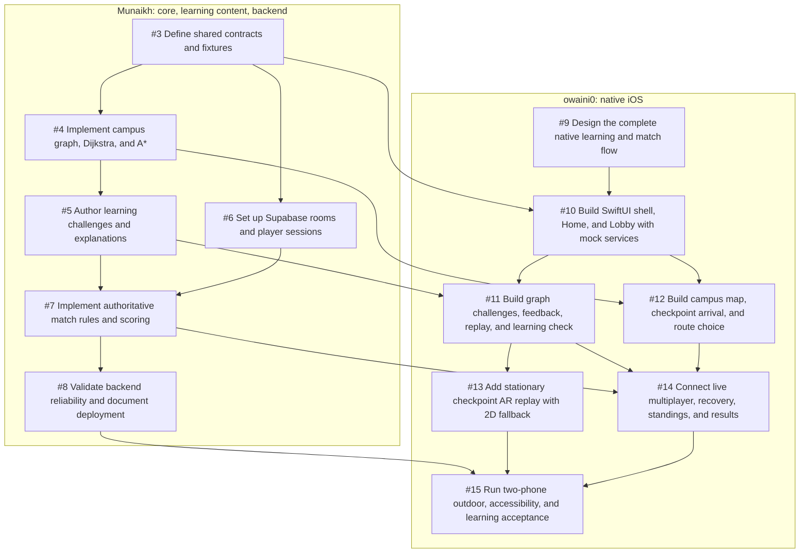

# Two-person implementation work breakdown

This is the agreed ownership and dependency map for the [Algorithm Arena MVP plan](PLAN.md). All implementation work starts open; the issue acceptance checklists define completion.

## Owners and immediate starting points

| Track | Owner | Parent issue | Start here |
| --- | --- | --- | --- |
| Algorithms, learning content, and backend | [Munaikh](https://github.com/Munaikh) | [#1](https://github.com/Munaikh/DYHTG-2026/issues/1) | [#3](https://github.com/Munaikh/DYHTG-2026/issues/3) shared contracts and fixtures |
| Native iOS experience, navigation, and AR | [owaini0](https://github.com/owaini0) | [#2](https://github.com/Munaikh/DYHTG-2026/issues/2) | [#9](https://github.com/Munaikh/DYHTG-2026/issues/9) editable native design |

The two starting tasks have no blockers and can begin together. After shared contracts are available, backend development and the mock-driven iOS shell proceed independently. Start with the plan's learning outcomes: one algorithm per match, worked explanations, shared feedback after both submissions, and an unscored transfer question.

## Munaikh: algorithms, learning content, and backend

Parent: [Part 1 — Algorithms, learning content, and backend](https://github.com/Munaikh/DYHTG-2026/issues/1).

| Implementation issue | Blocked by |
| --- | --- |
| [#3 — Define shared contracts and fixtures](https://github.com/Munaikh/DYHTG-2026/issues/3) | None; ready to start |
| [#4 — Implement campus graph, Dijkstra, and A*](https://github.com/Munaikh/DYHTG-2026/issues/4) | [#3](https://github.com/Munaikh/DYHTG-2026/issues/3) |
| [#5 — Author learning challenges and explanations](https://github.com/Munaikh/DYHTG-2026/issues/5) | [#4](https://github.com/Munaikh/DYHTG-2026/issues/4) |
| [#6 — Set up Supabase rooms and player sessions](https://github.com/Munaikh/DYHTG-2026/issues/6) | [#3](https://github.com/Munaikh/DYHTG-2026/issues/3) |
| [#7 — Implement authoritative match rules and scoring](https://github.com/Munaikh/DYHTG-2026/issues/7) | [#5](https://github.com/Munaikh/DYHTG-2026/issues/5), [#6](https://github.com/Munaikh/DYHTG-2026/issues/6) |
| [#8 — Validate backend reliability and document deployment](https://github.com/Munaikh/DYHTG-2026/issues/8) | [#7](https://github.com/Munaikh/DYHTG-2026/issues/7) |

## owaini0: native iOS experience, navigation, and AR

Parent: [Part 2 — Native iOS experience, navigation, and AR](https://github.com/Munaikh/DYHTG-2026/issues/2).

| Implementation issue | Blocked by |
| --- | --- |
| [#9 — Design the complete native learning and match flow](https://github.com/Munaikh/DYHTG-2026/issues/9) | None; ready to start |
| [#10 — Build SwiftUI shell, Home, and Lobby with mock services](https://github.com/Munaikh/DYHTG-2026/issues/10) | [#3](https://github.com/Munaikh/DYHTG-2026/issues/3), [#9](https://github.com/Munaikh/DYHTG-2026/issues/9) |
| [#11 — Build graph challenges, feedback, replay, and learning check](https://github.com/Munaikh/DYHTG-2026/issues/11) | [#5](https://github.com/Munaikh/DYHTG-2026/issues/5), [#10](https://github.com/Munaikh/DYHTG-2026/issues/10) |
| [#12 — Build campus map, checkpoint arrival, and route choice](https://github.com/Munaikh/DYHTG-2026/issues/12) | [#4](https://github.com/Munaikh/DYHTG-2026/issues/4), [#10](https://github.com/Munaikh/DYHTG-2026/issues/10) |
| [#13 — Add stationary checkpoint AR replay with 2D fallback](https://github.com/Munaikh/DYHTG-2026/issues/13) | [#11](https://github.com/Munaikh/DYHTG-2026/issues/11) |
| [#14 — Connect live multiplayer, recovery, standings, and results](https://github.com/Munaikh/DYHTG-2026/issues/14) | [#7](https://github.com/Munaikh/DYHTG-2026/issues/7), [#11](https://github.com/Munaikh/DYHTG-2026/issues/11), [#12](https://github.com/Munaikh/DYHTG-2026/issues/12) |
| [#15 — Run two-phone outdoor, accessibility, and learning acceptance](https://github.com/Munaikh/DYHTG-2026/issues/15) | [#8](https://github.com/Munaikh/DYHTG-2026/issues/8), [#13](https://github.com/Munaikh/DYHTG-2026/issues/13), [#14](https://github.com/Munaikh/DYHTG-2026/issues/14) |

Native GitHub sub-issues associate these 13 implementation tasks with the two parents. Native **blocked by / blocking** relationships represent the 19 dependency edges. The parents are organisational containers, not extra blockers. A dependency must meet its acceptance criteria and provide the agreed handoff before its dependants integrate it; drafting against the existing mocks is still possible.

## Dependency graph

Arrows run from a prerequisite to the issue it blocks.

## Ownership boundaries

These are planned implementation locations; this documentation change does not scaffold the application.

| Surface | Primary owner | Agreement |
| --- | --- | --- |
| `Packages/AlgorithmArenaCore/` | Munaikh | Foundation-only models, search engines, trace types, service protocol and core tests |
| `contracts/` | Munaikh, reviewed by both | Versioned command/snapshot examples and fixtures shared by Swift, server and mocks |
| Course and challenge data | Munaikh | Validated graph/heuristics, authored questions, answers and explanations; keep private match data out of public payloads |
| `supabase/` | Munaikh | Schema, functions, RLS, scoring, idempotency, configuration and backend verification |
| `DYHTG-2026/` | owaini0 | SwiftUI screens, navigation/state, live/mock adapters, MapKit/Core Location, RealityKit/ARKit and assets |
| `DYHTG-2026.xcodeproj/` | owaini0 | Package integration, signing/build configuration and app target membership |
| Editable Figma flow | owaini0 | Reference-led visual system, navigation and complete UI states |
| Outdoor/two-phone acceptance | owaini0 leads; Munaikh supports | Course survey, second player, backend diagnostics and learning observations |

Both review shared-contract changes. Keep backend rules out of views and reuse the core trace in both 2D and AR. Munaikh can add Swift package files without editing the Xcode project; owaini0 wires the package into the app.

## Handoffs and integration

1. **Contracts ([#3](https://github.com/Munaikh/DYHTG-2026/issues/3)):** agree algorithm/course/trace types, commands, authorised snapshots, error and reconnect semantics, pending feedback, idempotency, and arrival thresholds. Include fixtures for both algorithms and all major states. Both developers review before locking this dependency.
2. **Algorithms and content ([#4](https://github.com/Munaikh/DYHTG-2026/issues/4), [#5](https://github.com/Munaikh/DYHTG-2026/issues/5)):** provide validated course/heuristic data, deterministic route/trace fixtures, question definitions and worked explanations. UI development consumes those rather than calculating a separate answer in views.
3. **Mock-first iOS ([#10](https://github.com/Munaikh/DYHTG-2026/issues/10)–[#12](https://github.com/Munaikh/DYHTG-2026/issues/12)):** inject the same service interface that the live adapter will implement. A missing backend must not prevent exercising the planned screens against fixtures.
4. **Live backend ([#7](https://github.com/Munaikh/DYHTG-2026/issues/7)):** provide the integration endpoint, client-safe configuration, authorised snapshot examples and test-room/reset instructions. Keep secrets out of issues and source. Both developers reconcile fixture/implementation differences before connecting the client in [#14](https://github.com/Munaikh/DYHTG-2026/issues/14).
5. **Release evidence ([#8](https://github.com/Munaikh/DYHTG-2026/issues/8), [#15](https://github.com/Munaikh/DYHTG-2026/issues/15)):** share backend verification and physical-device evidence. Each developer fixes failures in their own track. Simulator success alone does not establish GPS/AR performance or learning outcomes.

Use one focused `feat/` branch per implementation issue, for example `feat/3-shared-contracts` and `feat/9-ios-design`. Link the implementation PR to its task with `Closes #<issue-number>`, include relevant acceptance evidence, and request the other developer's review for shared interfaces. Merge foundations before dependent integrations; avoid both developers editing the Xcode project or schema concurrently.

If a contract changes, update its examples/fixtures and describe the impact in the relevant issue or PR so the other track can adapt. If a new blocker is discovered, update the native relationship and this document. Do not silently bypass a pending-feedback gate, invent course access, award client-calculated points, or remove the learning check to make a demo pass.

## Requirement coverage

| Agreed requirement | Responsible issues |
| --- | --- |
| Learning outcomes, worked feedback and final understanding check | [#5](https://github.com/Munaikh/DYHTG-2026/issues/5), [#9](https://github.com/Munaikh/DYHTG-2026/issues/9), [#11](https://github.com/Munaikh/DYHTG-2026/issues/11), [#15](https://github.com/Munaikh/DYHTG-2026/issues/15) |
| Dijkstra and A*, deterministic traces and valid heuristics | [#3](https://github.com/Munaikh/DYHTG-2026/issues/3), [#4](https://github.com/Munaikh/DYHTG-2026/issues/4), [#5](https://github.com/Munaikh/DYHTG-2026/issues/5), [#8](https://github.com/Munaikh/DYHTG-2026/issues/8) |
| Two-player rooms, one selected algorithm, confirmation and shared start | [#6](https://github.com/Munaikh/DYHTG-2026/issues/6), [#7](https://github.com/Munaikh/DYHTG-2026/issues/7), [#10](https://github.com/Munaikh/DYHTG-2026/issues/10), [#14](https://github.com/Munaikh/DYHTG-2026/issues/14) |
| Three checkpoints, independent standard/bonus choice and route geometry | [#4](https://github.com/Munaikh/DYHTG-2026/issues/4), [#7](https://github.com/Munaikh/DYHTG-2026/issues/7), [#12](https://github.com/Munaikh/DYHTG-2026/issues/12), [#15](https://github.com/Munaikh/DYHTG-2026/issues/15) |
| Private answers, gated shared feedback and immediate middle feedback | [#3](https://github.com/Munaikh/DYHTG-2026/issues/3), [#5](https://github.com/Munaikh/DYHTG-2026/issues/5), [#7](https://github.com/Munaikh/DYHTG-2026/issues/7), [#8](https://github.com/Munaikh/DYHTG-2026/issues/8), [#11](https://github.com/Munaikh/DYHTG-2026/issues/11), [#14](https://github.com/Munaikh/DYHTG-2026/issues/14) |
| Exactly-once scoring, wrong-answer progression, winner/draw/incomplete | [#7](https://github.com/Munaikh/DYHTG-2026/issues/7), [#8](https://github.com/Munaikh/DYHTG-2026/issues/8), [#14](https://github.com/Munaikh/DYHTG-2026/issues/14), [#15](https://github.com/Munaikh/DYHTG-2026/issues/15) |
| Reconnect, persisted session/match and uncertain submission recovery | [#3](https://github.com/Munaikh/DYHTG-2026/issues/3), [#7](https://github.com/Munaikh/DYHTG-2026/issues/7), [#8](https://github.com/Munaikh/DYHTG-2026/issues/8), [#14](https://github.com/Munaikh/DYHTG-2026/issues/14) |
| GPS arrivals, organiser override, safe stopping areas and permissions | [#4](https://github.com/Munaikh/DYHTG-2026/issues/4), [#7](https://github.com/Munaikh/DYHTG-2026/issues/7), [#8](https://github.com/Munaikh/DYHTG-2026/issues/8), [#12](https://github.com/Munaikh/DYHTG-2026/issues/12), [#15](https://github.com/Munaikh/DYHTG-2026/issues/15) |
| AR trace replay with equivalent 2D fallback | [#11](https://github.com/Munaikh/DYHTG-2026/issues/11), [#13](https://github.com/Munaikh/DYHTG-2026/issues/13), [#15](https://github.com/Munaikh/DYHTG-2026/issues/15) |
| Native accessibility, motion, both themes and physical acceptance | [#9](https://github.com/Munaikh/DYHTG-2026/issues/9), [#10](https://github.com/Munaikh/DYHTG-2026/issues/10), [#11](https://github.com/Munaikh/DYHTG-2026/issues/11), [#15](https://github.com/Munaikh/DYHTG-2026/issues/15) |

## Completion gates

- Each child issue requires its own acceptance checklist and evidence; assignment does not mean the work is implemented.
- The final two-phone issue requires backend validation, AR and live client integration to be complete.
- Complete a Dijkstra match and an A* match, including different branches, a wrong answer, reconnect, replay and matching final results.
- Record first-attempt transfer-question performance and a verbal explanation of the next-node rule. Treat observed misconceptions as learning defects.
- Close each parent once its child tasks and shared integration obligations are complete.
